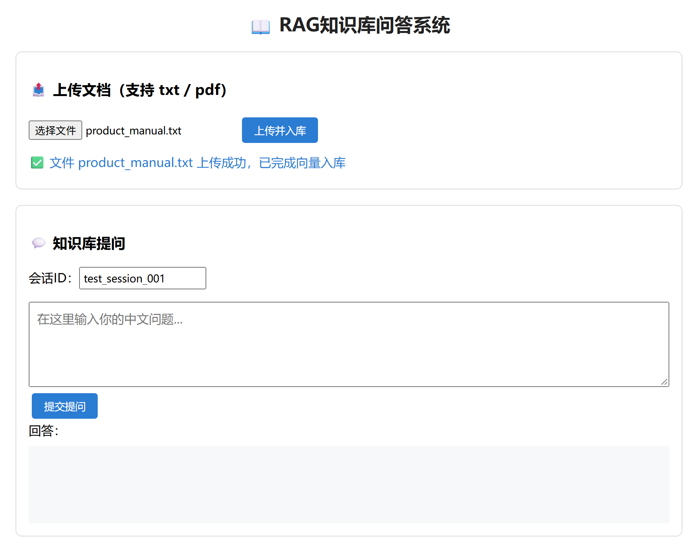
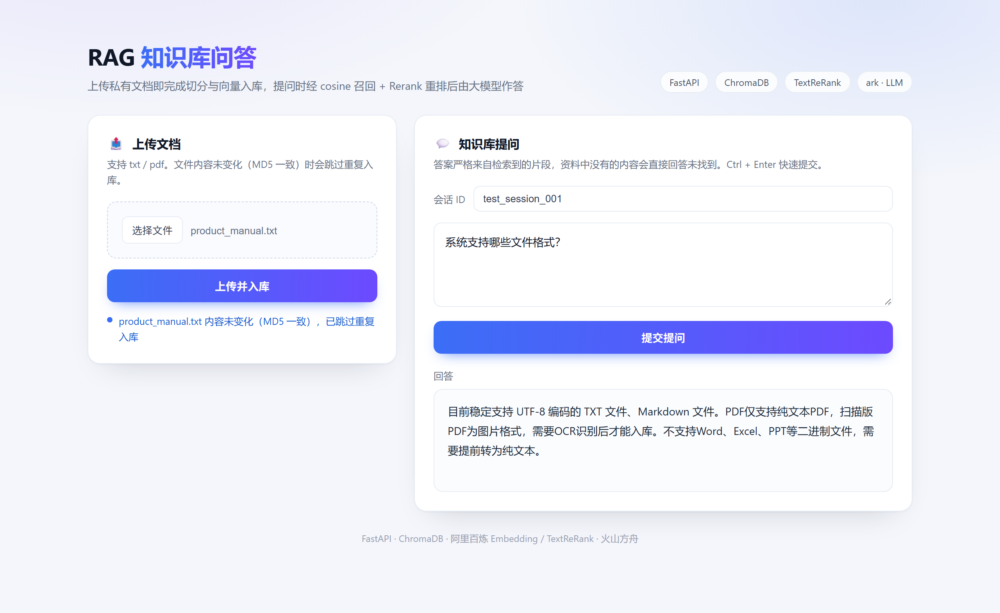

# 工程化 RAG 知识库问答

一个可增量更新的 RAG 问答服务：上传 `txt` / `pdf` 后自动切分、向量化入库，检索时先做 cosine 召回，再用阿里百炼 `TextReRank` 二次排序，最后由大模型流式回答。

## 功能

- **文档上传与解析**：`POST /upload_file` 支持 txt / pdf，PDF 用 `pdfplumber` 逐页抽取并清洗空白字符。
- **增量入库**：按文件 MD5 判断是否变更，未变更直接跳过；变更时先删除同源旧片段，再 `upsert` 新片段，避免重复 ID 和向量脏数据。
- **cosine 向量检索**：Chroma collection 固定使用 `hnsw:space=cosine`，相似度按 `1 - distance` 计算；检测到旧的非 cosine collection 会自动重建。
- **Rerank 重排**：向量召回 Top-K 后用 `TextReRank` 重排取 Top-N；Rerank 失败时降级为原始召回结果。
- **流式生成**：回答由火山方舟模型流式生成；外部检索接口异常时自动降级，问答不中断。
- **会话持久化**：SQLite 保存多轮会话，按 `MAX_CHAT_TURN` 带入最近历史。

## 演示

上传入库：新文件会切分、向量化并写入 Chroma；内容未变（MD5 一致）时提示跳过重复入库。



知识库问答：问题经 cosine 召回 + `TextReRank` 重排后交给大模型，答案完全来自私有文档。



> 截图来自本地真实运行（`uvicorn main:app`），非设计稿。

## 技术栈

FastAPI · ChromaDB · OpenAI 兼容 SDK（火山方舟 Ark）· 阿里百炼 Embedding / Rerank · pdfplumber · SQLite

## 目录结构

```text
.
├── main.py             # 文档解析 / 增量入库 / 检索 / 流式问答 / FastAPI 接口
├── index.html          # 上传 + 问答页面
├── data/               # 知识库原始文件（txt / pdf）
├── docs/               # README 演示截图
├── requirements.txt
├── .env.example
└── LICENSE
```

## 快速开始

```bash
python -m venv .venv
source .venv/bin/activate        # Windows: .venv\Scripts\activate
pip install -r requirements.txt

cp .env.example .env             # 填入 Ark 与 DashScope 密钥

uvicorn main:app --host 0.0.0.0 --port 8000
```

打开 <http://127.0.0.1:8000> 即可上传文档并提问。启动时会初始化 SQLite、扫描 `data/` 做增量入库。

也可以直接命令行交互：

```bash
python main.py
```

## 接口

| 方法 | 路径 | 说明 |
| --- | --- | --- |
| `GET` | `/` | 上传 + 问答页面 |
| `POST` | `/upload_file` | `multipart/form-data`，字段名 `file`，仅支持 `.txt` / `.pdf`；上传后立即增量入库 |
| `POST` | `/rag/query` | `{"session_id": "...", "question": "..."}`，返回完整回答 JSON |

`/rag/query` 内部使用流式生成，接口层聚合后一次性返回；页面侧展示最终答案。

## 设计要点

- **幂等入库**：`ids = 文件名:片段序号`，写入前先 `delete(where={"source": 文件名})`，再用 `upsert` 写入，重复上传同一文件不会抛 `DuplicateIDError`。
- **元数据可追溯**：每个片段保存 `source` 与 `chunk_index`，便于定位来源与清理。
- **相似度口径统一**：cosine 空间下 `distance = 1 - cosine`，相似度直接取 `1 - distance`，不再使用与距离度量无关的经验换算。
- **失败可降级**：Embedding 超时后熔断 60 秒，改用本地中文 bigram 关键词检索（直接扫 Chroma 语料，不依赖外部接口）；Rerank 超时或失败则退化为向量召回顺序，问答链路不因外部接口抖动整体失败。
- **冷启动预热**：启动后由后台任务预热一次检索链路 + LLM 端点，首个用户请求不再承担 TLS 握手、索引加载与模型首包开销；预热失败只告警，不阻塞启动。

## 局限与 Roadmap

- 切分为固定窗口 + overlap，长表格和跨页段落的效果有限，可改为按标题/段落切分。
- 未内置检索评测集，后续可补充 hit@k / MRR 指标。
- 当前为单机 SQLite + 本地 Chroma，规模化可替换为向量数据库服务与对象存储。

## License

[MIT](LICENSE)
